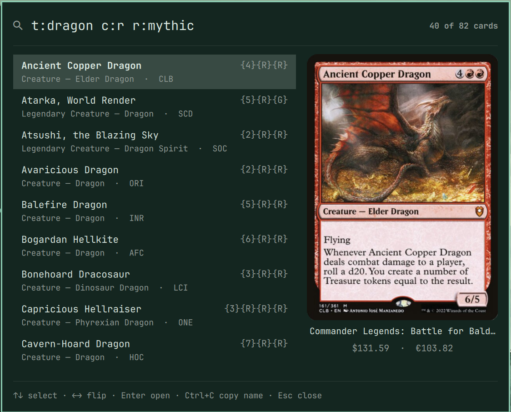
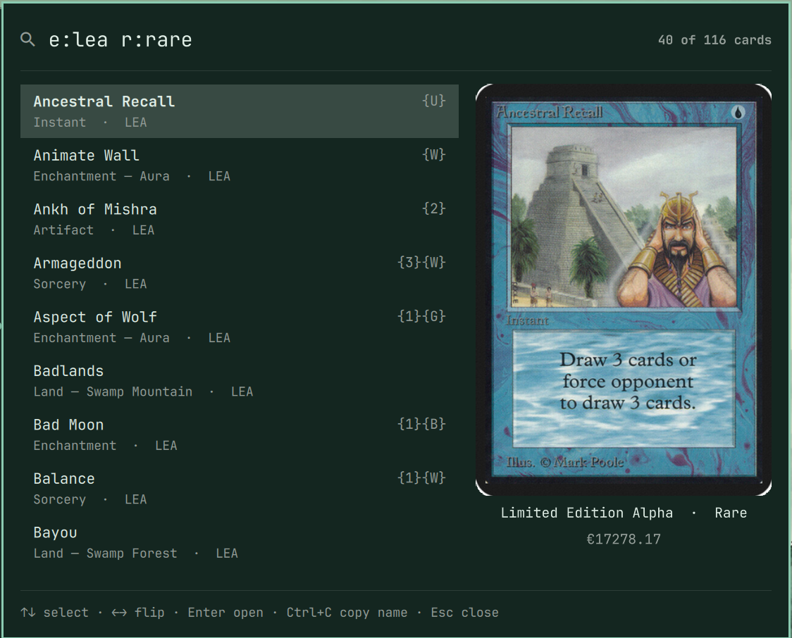
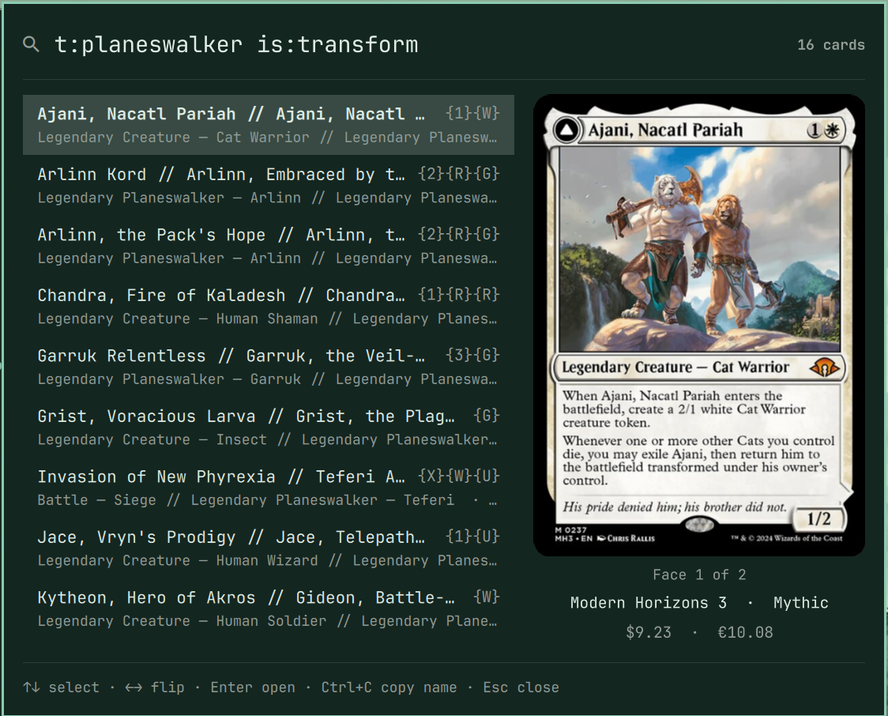

# MTG Card Search for Omarchy

An [Omarchy](https://omarchy.org/) shell plugin that searches Magic: The
Gathering cards from the bar, using the [Scryfall API](https://scryfall.com/docs/api).

Click the cards icon, type a card name or any
[Scryfall query](https://scryfall.com/docs/syntax), such as `t:dragon c:r` or
`o:"draw a card" cmc<=2`, and pick a card from the list. The panel shows the
card's image, set, rarity and prices, flips double-faced cards, and opens the
full card page on scryfall.com.



## Install

```bash
omarchy plugin add https://github.com/bastos/omarchy-mtg-search.git --enable
```

Omarchy clones the repository, validates `manifest.json`, asks where in the
bar to put the icon (right section by default), and enables it. Plugins run
unsandboxed inside the Omarchy shell with your user's permissions, so review
the source before you accept the install prompt.

Update with `omarchy plugin update bastos.mtg-search`. Remove with
`omarchy plugin remove bastos.mtg-search`.

### Requirements

- Omarchy with the Quickshell-based shell (`omarchy plugin` commands).
- `curl` for API requests and `wl-copy` (wl-clipboard) to copy card names.
  Omarchy ships both.

## Usage

Typing searches once you stop for a moment, from three characters. Press
Enter to search a shorter query right away.

Any [Scryfall search](https://scryfall.com/docs/syntax) works: sets, rarities,
rules text, card types and more. Double-faced cards show "Face 1 of 2" and
flip with ← / →.

<p>
  
  
</p>

| Key | Action |
|-----|--------|
| ↑ / ↓, Ctrl+J / Ctrl+K, Ctrl+N / Ctrl+P | Move through results |
| Page Up / Page Down | Move five results |
| ← / → (or click the image) | Flip a double-faced card |
| Enter (or double-click) | Open the card on scryfall.com |
| Ctrl+C | Copy the card name |
| Ctrl+U / Ctrl+Backspace | Clear the search / delete a word |
| Tab / Shift+Tab | Switch to the neighbouring bar panel |
| Esc | Close |

From a script or a keybinding:

```bash
omarchy-shell bastos.mtg-search toggle
omarchy-shell bastos.mtg-search search "lightning bolt"
```

## Settings

Set these in the widget's entry in `~/.config/omarchy/shell.json`. The shell
picks up changes on save.

| Key | Default | Meaning |
|-----|---------|---------|
| `maxResults` | `40` | Cards listed, 10 to 175 |
| `order` | `"name"` | Sort order: `name`, `released`, `edhrec`, `usd`, `cmc` or `rarity` |
| `showPrices` | `true` | Show Scryfall's USD and EUR prices |

```json
{ "id": "bastos.mtg-search", "maxResults": 60, "order": "usd" }
```

## Network use

Scryfall's [rate limits](https://scryfall.com/docs/api/rate-limits) cap
`/cards/search` at 2 requests a second, lock a client out for 30 seconds
after an HTTP 429, and ask that results be cached for at least 24 hours. The
plugin stays well inside them. The limiter and cache live in `Model.js`, which
the shell loads once and shares across every monitor's bar.

- Requests go to `https://api.scryfall.com` only while the panel is open.
  Nothing runs in the background, and closing the panel drops any search
  still waiting to be sent.
- Typing waits 400 ms for keystrokes to settle and searches only from three
  characters.
- One request is in flight at a time. Queries typed meanwhile collapse into
  the newest one.
- Searches start at least one second apart, half of Scryfall's limit.
- Successful results are cached in memory for 24 hours, up to 20 queries.
  Backspacing, reopening, re-sorting to something already seen, or changing
  `maxResults` sends nothing.
- An HTTP 429 pauses all searching for 35 seconds, doubling on each repeat
  within ten minutes, up to ten minutes. The panel shows a countdown, then
  retries the latest query once.
- Other failures are never retried automatically.
- Card images load from `https://cards.scryfall.io`, which has no rate limit.
- Every request identifies the plugin and this repository in its
  User-Agent, as Scryfall asks.

## Safety

- `curl` runs from an argument array with an 8 second timeout and an 8 MB
  cap. The query is percent-encoded into the URL and never reaches a shell.
- Every field from the API is length-bounded and validated in `Model.js`.
  Only `https://cards.scryfall.io` images and `https://scryfall.com/card/`
  links are used.
- All text renders as `Text.PlainText`, so card data shaped like markup
  cannot load anything. A test fails if any text in the plugin could render
  as rich text.

## Development

The plugin lives in `~/.config/omarchy/plugins/bastos.mtg-search/` once
installed.

```bash
node --test tests/
omarchy plugin validate .
```

The tests cover parsing and validation of Scryfall's responses, the rate
limiter, the cache and the search state machine, and check that every QML
text is plain text and every translation key exists.

Saving a file reloads the plugin, but the shell can keep the previous
`Model.js` and `Panel.qml` cached. If a change does not show up, run
`omarchy restart shell`.

Strings live in `i18n/en.json`. To add a language, add a catalog named after
its Omarchy language code, such as `i18n/pt-BR.json`. Missing strings fall
back to English.

## Credits

Card data and images come from [Scryfall](https://scryfall.com/). This plugin
is not produced by or endorsed by Scryfall.

MTG Card Search is unofficial Fan Content permitted under the
[Fan Content Policy](https://company.wizards.com/en/legal/fancontentpolicy).
Not approved/endorsed by Wizards. Portions of the materials used are property
of Wizards of the Coast. ©Wizards of the Coast LLC.

## License

[MIT](LICENSE)
